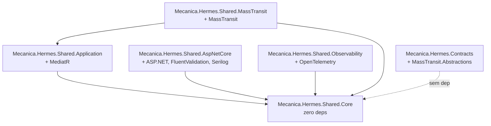

# Arquitetura do SDK

O SDK é distribuído como **6 pacotes NuGet independentes**, organizados em camadas
de dependência crescente. A regra é simples: cada pacote só pode depender dos que
estão acima dele na pirâmide.



## Tabela dos pacotes

| Pacote | Tier | Conteúdo | Dependências externas |
|---|---|---|---|
| `Mecanica.Hermes.Shared.Core` | 1 | `Result<T>`, `BaseDomain`, `AggregateRoot`, `IDomainEvent`, `DomainEventNameAttribute`, `DomainClock`, `IUnitOfWork`, `ConcurrencyConflictException`, `PaginationParams`, `PagedResult` | nenhuma |
| `Mecanica.Hermes.Shared.Application` | 1 | `IAsyncCommand`, `IAsyncMessagePublisher`, `AsyncCommandHandler`, `LoggingBehavior` | `MediatR`, `Microsoft.Extensions.Logging.Abstractions` |
| `Mecanica.Hermes.Shared.AspNetCore` | 1 | `CorrelationIdMiddleware`, `DevelopmentAuthenticationMiddleware`, `MiddlewareExtensions`, `ValidationFilter<T>`, `ApiProblemDetails`, `EndpointConventions`, `HealthCheckTags` | ASP.NET Core, FluentValidation, Serilog |
| `Mecanica.Hermes.Shared.Observability` | 1 | `ActivitySources`, `OtlpEnvironment`, `EnvironmentDetector`, hooks de `ObservabilityConfiguration` | `OpenTelemetry.*` |
| `Mecanica.Hermes.Shared.MassTransit` | 2 | (planejado) `ConfigureSaga<TStateMachine, TState>` genérico, `BusFactoryConfiguratorExtensions`, `MassTransitMessagePublisher`, `KebabCaseEndpointNameFormatterFactory` | `MassTransit`, `MassTransit.RabbitMQ` |
| `Mecanica.Hermes.Contracts` | — | 7 integration events versionados via `[EntityName(...".v1")]` | `MassTransit.Abstractions` |

## Princípios de design

### 1. Core sem dependências externas

`Mecanica.Hermes.Shared.Core` **não pode** referenciar nada fora da BCL. Esta
restrição é deliberada — qualquer regra ali fica utilizável em projetos que
não usam MediatR / MassTransit / ASP.NET.

### 2. Application depende só de MediatR

A camada `Application` carrega o que é genuinamente sobre orquestração de comandos
(`AsyncCommandHandler`, `LoggingBehavior`). Tracing/Telemetry específico
(via `Activity`) fica em `Observability` — Application não conhece OpenTelemetry.

### 3. AspNetCore concentra middleware HTTP

Tudo que toca `HttpContext` mora aqui. Inclui o `DevelopmentAuthenticationMiddleware`
parametrizável (cada API consumidora informa seu conjunto de scopes via Options).

### 4. Contracts é desacoplado dos demais pacotes

`Mecanica.Hermes.Contracts` **não** referencia nem `Core` nem `Application` —
um consumidor pode usar só os contratos sem trazer o resto do SDK. Esta separação
é estratégica para futuros consumidores externos (front-end .NET, BFF, jobs
isolados) que só precisam serializar/deserializar eventos.

### 5. MassTransit é Tier 2 (planejado)

O pacote existe como skeleton no v1.0; código real será migrado depois que os
3 repos consumirem os pacotes Tier 1. Razão: refactors em `MassTransit` exigem
genericização (`ConfigureSaga<TStateMachine, TState>`) e validação cross-repo
do `KebabCaseEndpointNameFormatter` — risco maior, melhor isolar em release próprio.

## Estrutura de pastas

```
mecanica-hermes-shared-sdk/
├── Directory.Build.props          # versão única + metadados NuGet (Source Link, símbolos, README)
├── Directory.Packages.props       # Central Package Management — todas as versões aqui
├── Mecanica.Hermes.Shared.slnx    # solução .slnx (formato novo)
├── global.json                    # SDK 10.0.100
├── LICENSE                        # MIT
├── README.md
├── docs/
│   ├── architecture.md            # este arquivo
│   ├── ci-cd.md                   # workflows e publicação
│   ├── consuming.md               # como os 3 repos consomem o SDK
│   └── versioning.md              # política de SemVer e evolução de contratos
├── .github/workflows/
│   ├── build-and-tests-ci.yml
│   ├── format-ci.yml
│   ├── publish-nuget.yml
│   └── sonarqube-ci.yml
├── src/
│   ├── Mecanica.Hermes.Shared.Core/
│   ├── Mecanica.Hermes.Shared.Application/
│   ├── Mecanica.Hermes.Shared.AspNetCore/
│   ├── Mecanica.Hermes.Shared.Observability/
│   ├── Mecanica.Hermes.Shared.MassTransit/
│   └── Mecanica.Hermes.Contracts/
└── tests/
    └── Mecanica.Hermes.Shared.Tests/   # smoke tests (Core + Contracts)
```

## Central Package Management

Todas as versões de pacotes vivem em `Directory.Packages.props` (raiz). Os `.csproj`
declaram `<PackageReference Include="..." />` **sem `Version=`**. Isso garante que
os 6 projetos compartilhem versões idênticas de MediatR, OpenTelemetry, MassTransit
etc., evitando o "diamond dependency problem".

## Source Link e símbolos

`Directory.Build.props` ativa:

- `IncludeSymbols=true` + `SymbolPackageFormat=snupkg` — gera `.snupkg` separado.
- `PublishRepositoryUrl=true`, `EmbedUntrackedSources=true` — Source Link funciona
  em qualquer consumidor com debugger.
- `Microsoft.SourceLink.GitHub` referenciado em todos os `.csproj` com
  `PrivateAssets="All"`.

Resultado: ao depurar uma API consumidora e entrar em código do SDK, o Visual
Studio / Rider baixa o source do GitHub correspondente ao commit publicado.

## Princípio de migração ("zero refactor")

A migração dos 3 repos para v1.0.0 deve ser **só `using` + `<PackageReference>`**.
Nenhum tipo público mudou de assinatura em relação às versões originais nos repos.

Refactors com mudança de API (parametrização de `DevelopmentAuthenticationMiddleware`,
hooks no `GlobalExceptionHandlerMiddleware`, `ConfigureSaga` genérico) ficam para
v1.1.x — opt-in via versão maior.
