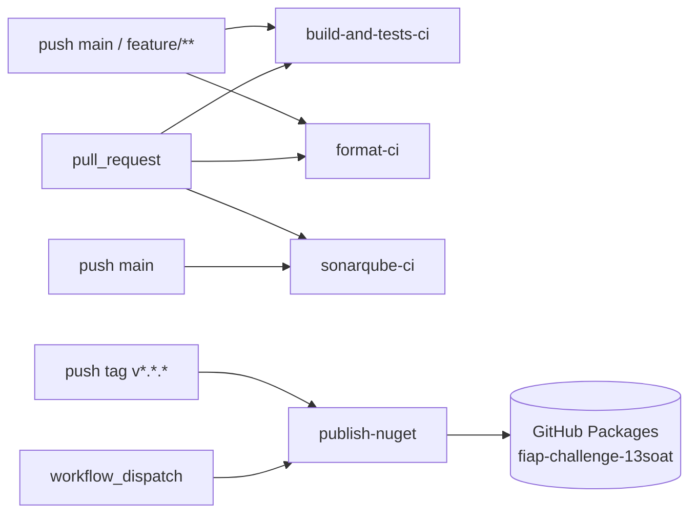

# CI / CD

Quatro workflows do GitHub Actions automatizam build, qualidade, formato e publicação dos pacotes NuGet.



## Workflow 1 — `build-and-tests-ci.yml`

**Triggers:** push em `main` e `feature/**`; `pull_request` para `main`.

### Etapas

1. Checkout (`actions/checkout`).
2. Setup .NET 10 (`actions/setup-dotnet`) — versão lida do `global.json`.
3. Cache de NuGet (chave: `runner.os` + hash de `Directory.Packages.props`).
4. `dotnet restore Mecanica.Hermes.Shared.slnx`.
5. `dotnet build --configuration Release --no-restore`.
6. `dotnet test --configuration Release --no-build` — roda os smoke tests
   (`Mecanica.Hermes.Shared.Tests`).
7. `dotnet pack --configuration Release --no-build --output ./artifacts` —
   gera os 6 `.nupkg` em **modo preview** (versão herdada do `Directory.Build.props`,
   ex.: `1.0.0-preview1`).
8. Publica artefato `nupkgs` (retenção 7 dias) — útil para inspecionar o pacote
   antes de fazer release oficial.

### Equivalente local

```bash
just test-release   # build + test em Release (mesma config do CI)
just pack           # gera os mesmos 6 .nupkg em ./artifacts
```

### Permissões e secrets

| Item | Valor |
|---|---|
| `permissions.contents` | `read` |
| `permissions.packages` | `read` |
| Secrets adicionais | nenhum |

> O job declara `packages: read` apenas como reserva — o build atual não consome
> pacotes da org. Se houver `<PackageReference>` interno futuro, esse acesso já
> está habilitado.

## Workflow 2 — `format-ci.yml`

**Triggers:** `pull_request` para `main`; `push` em `main`.

### Etapas

1. Checkout + Setup .NET 10.
2. `dotnet restore Mecanica.Hermes.Shared.slnx`.
3. `dotnet format whitespace --verify-no-changes` — checa whitespace/EOL/indent
   contra o `.editorconfig`.
4. `dotnet format style --verify-no-changes` — checa convenções (uso de `var`,
   ordenação de `using`, `this.` etc.).
5. `dotnet format analyzers --verify-no-changes` — roda os analyzers
   configurados (`CA*`, `IDE*`).
6. **Verificação custom de comprimento de linha** (`max_line_length=120`)
   — varre `src/` e `tests/` (excluindo `bin/`, `obj/`, `Migrations/`) e falha
   o pipeline com `::error::` se alguma linha exceder.
7. **Step `Dica de correção`** (executa só em falha) — instrui o dev a rodar
   `dotnet format` localmente.

### Equivalente local

```bash
just format-check   # roda exatamente as 4 checagens do CI (whitespace, style, analyzers, line-length)
just format         # aplica as correções automaticamente
```

Sem `just`:

```bash
dotnet format Mecanica.Hermes.Shared.slnx
```

## Workflow 3 — `sonarqube-ci.yml`

**Dashboard:** [sonarcloud.io/summary/new_code?id=fiap-challenge-13soat_mecanica-hermes-shared-sdk](https://sonarcloud.io/summary/new_code?id=fiap-challenge-13soat_mecanica-hermes-shared-sdk)

**Triggers:**

- `pull_request` (`opened`, `synchronize`, `reopened`) — análise com decoração no PR.
- `push` em `main` — análise da branch principal (linha de base do Quality Gate).

### Etapas

1. Checkout com `fetch-depth: 0` (necessário para análise de blame/SCM).
2. Setup do JDK 17 (`zulu`) — requisito do scanner.
3. Setup .NET 10.
4. Caches independentes: NuGet, pacotes do SonarCloud (`~/.sonar/cache`) e o
   próprio scanner (`dotnet-sonarscanner`, versão pinada em `SONAR_SCANNER_VERSION`).
5. Instala o `dotnet-sonarscanner` no `runner.temp` se o cache não bater.
6. **Begin/Build/Test/End** numa única step:
   - `dotnet-sonarscanner begin` com chave do projeto, organização, host,
     exclusões (`**/Program.cs`, `**/tests/**`, `**/bin/**`, `**/obj/**`)
     e `sonar.cs.opencover.reportsPaths`.
   - Em eventos `pull_request`, adiciona `sonar.pullrequest.key/branch/base`.
   - `dotnet build Mecanica.Hermes.Shared.slnx --configuration Release`.
   - `dotnet test --no-build --settings coverlet.runsettings` — gera o
     relatório OpenCover em `.temp/coverage/**/coverage.opencover.xml`.
   - `dotnet-sonarscanner end` envia tudo para o SonarCloud.

### Configurações de segurança

- `permissions:` mínimas (`contents: read`, `pull-requests: read`).
- `concurrency:` por `github.ref` com `cancel-in-progress: true` — evita análises
  redundantes em pushes consecutivos no mesmo PR.
- Token só via env (`SONAR_TOKEN`) — não passado em linha de comando.
- Refs do PR (`head_ref`, `base_ref`, número) expostos via `env:` antes de entrar
  no `run:` — evita risco de injeção via nome de branch.

### Secrets necessários

| Secret | Descrição |
|---|---|
| `SONAR_TOKEN` | Token gerado em SonarCloud → My Account → Security. |

## Workflow 4 — `publish-nuget.yml`

Responsável por **publicar os 6 pacotes em GitHub Packages**. Não roda automaticamente
no merge de `main` — exige um gate manual (tag SemVer ou `workflow_dispatch`)
para evitar releases acidentais.

**Triggers:**

| Evento | Comportamento |
|---|---|
| `push` em tag `v*.*.*` | Versão = a tag sem o prefixo `v` (ex.: tag `v1.0.0` → versão `1.0.0`). |
| `workflow_dispatch` | Versão lida do input `version` (default `1.0.0-preview1`). |

### Etapas

1. Checkout + Setup .NET 10.
2. **Step `Determinar versão`** — resolve a versão a partir do trigger (tag ou
   input) e exporta como `steps.version.outputs.version`.
3. `dotnet restore Mecanica.Hermes.Shared.slnx`.
4. `dotnet build -c Release --no-restore /p:Version=<versão>` — força a versão
   resolvida em todos os 6 `.csproj` (sobrescreve o default do `Directory.Build.props`).
5. `dotnet test -c Release --no-build` — roda os smoke tests; release não sai
   se algum teste falhar.
6. `dotnet pack -c Release --no-build -o ./artifacts /p:Version=<versão>` —
   gera os 6 `.nupkg` + 6 `.snupkg` (símbolos via `IncludeSymbols=true` no
   `Directory.Build.props`).
7. Upload de artefato `nupkgs-<versão>` (retenção 90 dias) — backup do release
   independente do GitHub Packages.
8. **Push para GitHub Packages**:
   ```bash
   dotnet nuget push "./artifacts/*.nupkg" \
     --source "https://nuget.pkg.github.com/fiap-challenge-13soat/index.json" \
     --api-key "${{ secrets.GITHUB_TOKEN }}" \
     --skip-duplicate
   ```
   `--skip-duplicate` evita falha se a versão já existir (idempotência do release).

### Permissões

| Item | Valor |
|---|---|
| `permissions.contents` | `read` |
| `permissions.packages` | `write` |

> **Pré-requisito de organização:** o `GITHUB_TOKEN` injetado pelo Actions só
> consegue gravar em GitHub Packages se a org permitir. Em
> **`fiap-challenge-13soat` → Settings → Actions → General → Workflow permissions**
> deve estar marcado **`Read and write permissions`**. Sem isso, o push falha
> com `403 Forbidden` mesmo com `permissions: packages: write` declarado.

### Como fazer um release oficial

1. PR mergeado em `main` com a versão alvo definida no `Directory.Build.props`
   (ex.: `1.0.0`).
2. Tag SemVer no commit de release:
   ```bash
   git tag -a v1.0.0 -m "Release 1.0.0"
   git push origin v1.0.0
   ```
3. O workflow dispara, builda, testa, packa e publica os 6 pacotes na versão `1.0.0`.
4. Verificar em `https://github.com/orgs/fiap-challenge-13soat/packages` que os
   6 pacotes apareceram.

### Como fazer um pre-release manual

1. Acionar o workflow via UI (Actions → Publish to GitHub Packages → Run workflow).
2. Informar a versão (ex.: `1.0.0-preview2`).
3. Mesmo fluxo, sem tag git.

## Visibilidade do pacote

Os pacotes são publicados em **GitHub Packages**, não em
[`nuget.org`](https://www.nuget.org). A visibilidade do pacote herda da
visibilidade do repo source:

| Repo `mecanica-hermes-shared-sdk` | Pacote no GitHub Packages | Restore por terceiros |
|---|---|---|
| Public | Public — qualquer um lê | anônimo |
| Private (default) | Private — só membros da org leem | exige PAT com `read:packages` |

Detalhes de consumo nos 3 repos da Mecânica Hermes em [`consuming.md`](./consuming.md).

## Resumo de secrets e permissões

| Workflow | Secrets | `permissions` |
|---|---|---|
| `build-and-tests-ci` | — | `contents: read`, `packages: read` |
| `format-ci` | — | `contents: read` |
| `sonarqube-ci` | `SONAR_TOKEN` | `contents: read`, `pull-requests: read` |
| `publish-nuget` | `GITHUB_TOKEN` (automático) | `contents: read`, `packages: write` |
